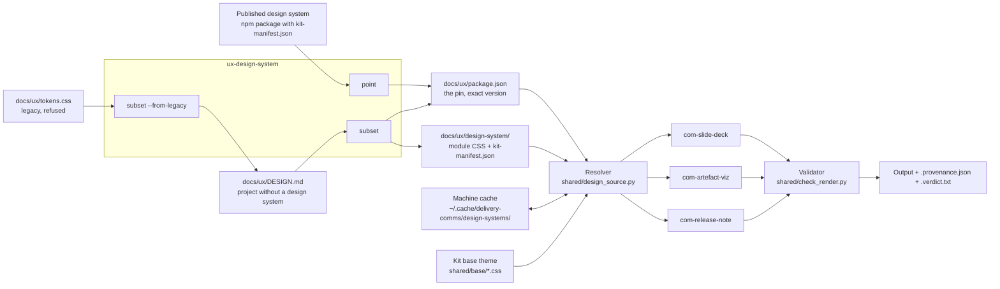
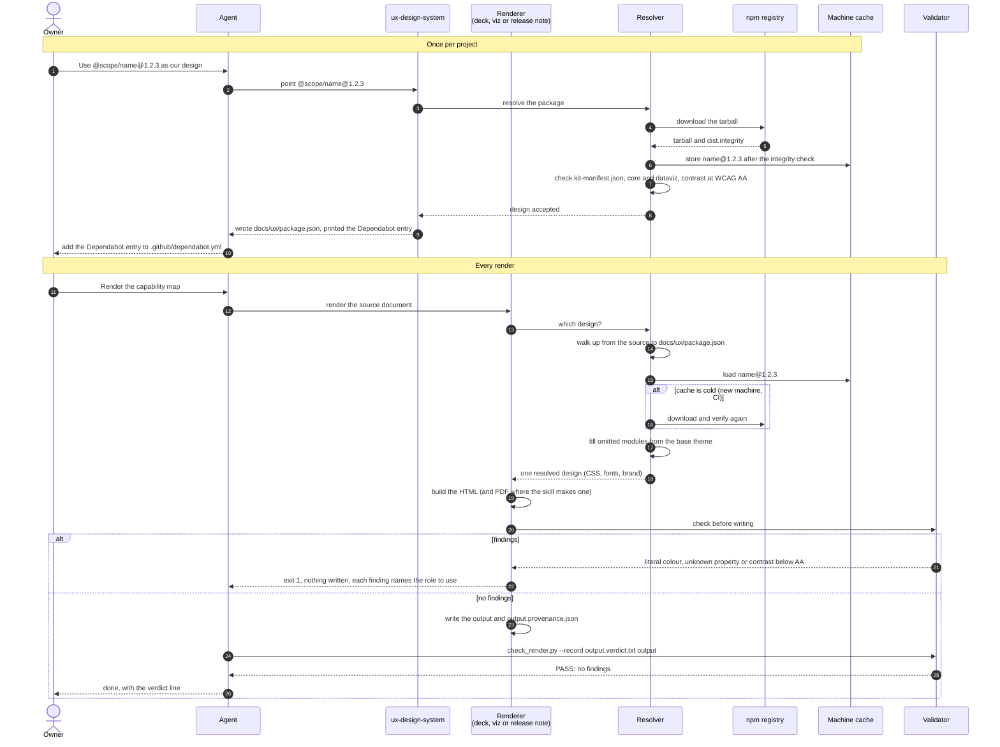

# delivery-comms

Four skills that turn a project's documents into things people read: slide decks and A4 documents, interactive views of kit artefacts, and stakeholder release notes, all in the project's own design system. This page shows how the skills fit together, what each one reads and what it writes. How to run each one is in its `SKILL.md`; the design contract itself is [`contract/README.md`](contract/README.md); what changed in each version is [`CHANGELOG.md`](CHANGELOG.md).

## The four skills

| Skill | Role | Detail |
|---|---|---|
| `ux-design-system` | Gives the project its design: pins a published design system, or builds a small one from a `DESIGN.md` | [SKILL.md](skills/ux-design-system/SKILL.md) · [README](skills/ux-design-system/README.md) |
| `com-slide-deck` | Builds slide decks and A4 documents from partials | [SKILL.md](skills/com-slide-deck/SKILL.md) · [README](skills/com-slide-deck/README.md) |
| `com-artefact-viz` | Renders kit artefacts (capability map, FBS, roadmap, canvas, service blueprint) as interactive HTML views | [SKILL.md](skills/com-artefact-viz/SKILL.md) · [README](skills/com-artefact-viz/README.md) |
| `com-release-note` | Curates a plain-language release note from a release's changelog and history, then renders it as a report | [SKILL.md](skills/com-release-note/SKILL.md) |

`ux-design-system` is the only skill that writes the design. The other three are renderers: they only read it. All four carry the same copy of the shared scripts in `shared/` (the resolver `design_source.py`, the validator `check_render.py` and the base theme), so each skill works on its own.

## How they relate



Read it left to right. A project gets its design once, through `ux-design-system`: either a pin to a published package, or a `DESIGN.md` turned into a local design-system folder (a legacy `tokens.css` is first drafted into a `DESIGN.md`). From then on, every render of every renderer goes through the same resolver, which finds the pin, loads the design (from the machine cache, downloading it the first time), fills the modules the design leaves out from the kit's base theme, and hands one resolved design to the renderer. Every output then passes the validator before it is written.

## A render, step by step



The resolver refuses (exit 2) instead of rendering when the design is wrong: a legacy `tokens.css` with no pin, a manifest that does not match the schema, a missing `core` or `dataviz` module, or text pairs below WCAG AA. Its message names the `ux-design-system` command that fixes it. A project with no design source at all renders on the base theme, and its provenance report says so.

## What each skill reads and writes

| Skill | Reads | Writes |
|---|---|---|
| `ux-design-system point` | A package name at an exact version (or a local design-system folder, for previewing) | `docs/ux/package.json`; prints the Dependabot entry (never writes `.github/dependabot.yml`) |
| `ux-design-system scaffold` | Nothing | A `docs/ux/DESIGN.md` template |
| `ux-design-system subset` | `docs/ux/DESIGN.md` (Google DESIGN.md format, with a `kit.omitted` list) | `docs/ux/design-system/` (module CSS and `kit-manifest.json`) and the pin `file:design-system` in `docs/ux/package.json`; proposes a chart palette when the chart colours are missing |
| `ux-design-system subset --from-legacy` | A legacy `docs/ux/tokens.css` (never edited) | A draft `docs/ux/DESIGN.md` with a proposed chart palette, for the owner to review |
| `com-slide-deck` | The deck project made by `init.py`: `config.yaml`, `context/brief.md`, `context/bibliography.yaml`, slide partials in `output/slides/`, `design/styles.css` (deck components only) | The deck as one HTML file (default `output/slide-deck/`), optionally a PDF (`render.py`, needs Playwright), each with its `.provenance.json` |
| `com-artefact-viz` | One canonical artefact: capability map `docs/business/03a-capability-map.md`, FBS `docs/product-specs/07a-fbs.md`, delivery roadmap `docs/plans/delivery-roadmap.md`, BMC or Lean Canvas `docs/business/02a-*.md`; or, for a service blueprint, a process, a value stream and a personas folder | One self-contained HTML view (default `docs/communication/visualisations/<kind>.html`) and its `.provenance.json` |
| `com-release-note` | `CHANGELOG.md`, the commits and merged PRs between two tags, and when present the FBS and the capability map | The committed note `docs/communication/release-notes/<version>-<slug>.md` and a GitHub Release body; in render mode `pdf/<stem>.html`, `pdf/<stem>.pdf` and `.provenance.json` next to the note |

Every renderer also takes the design through the resolver, and after every render the agent writes `<output>.verdict.txt` with the validator. An output is not done until its verdict reads `PASS: no findings`.

The renderers never author content. `com-artefact-viz` only draws artefacts that their own skills wrote (`business-capability-map`, `spec-functional-breakdown-structure`, `plan-delivery-roadmap`, `business-model-canvas`, `business-process`, `business-value-stream`, `business-persona`), and `com-release-note` reads the FBS and capability map for structure only.

## What a project ends up with

```text
docs/ux/
  package.json              the pin (one dependency, exact version, or file:design-system)
  DESIGN.md                 only for a project without a published design system
  design-system/            generated by subset from DESIGN.md: module CSS + kit-manifest.json
.github/dependabot.yml      an npm entry for /docs/ux, so design-system bumps arrive as pull requests
AGENTS.md                   optionally, the five-line block from skills/ux-design-system/references/agents-md-block.md
<any output>                next to it: <output>.provenance.json and <output>.verdict.txt
```

Nothing goes in `node_modules`: the kit downloads the pinned tarball itself and caches it per machine under `${XDG_CACHE_HOME:-~/.cache}/delivery-comms/design-systems/<name>@<version>/`.

## Two properties every output has

- **Provenance.** `<output>.provenance.json` records the design's name and version, which modules came from the design and which from the base theme, and any declared local exceptions.
- **Reproducible.** The same source and the same design give the same bytes. Dates come from the source (`SOURCE_DATE_EPOCH`, else the source's last commit), never the clock, and printed paths are relative to the repository. See [ADR-0013](../../docs/architecture/decisions/adr-0013-reproducible-delivery-comms-output.md).
